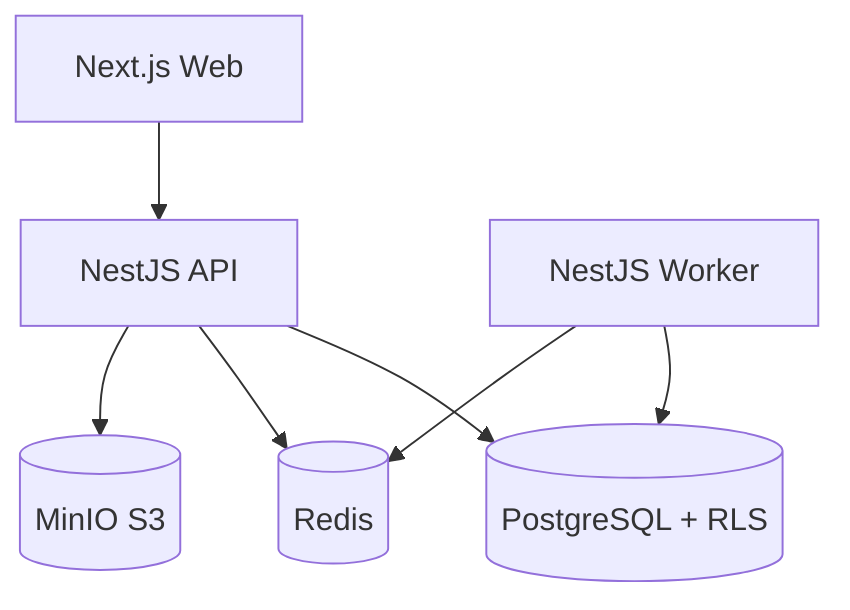

# Eduvy — Visão geral da arquitetura

## Estado atual

Monorepo pnpm com:

| Pacote | Responsabilidade |
|--------|------------------|
| `@eduvy/web` | Next.js 16 — landing, login, plataforma (mocks) |
| `@eduvy/api` | NestJS — API REST `/api/v1` |
| `@eduvy/worker` | BullMQ — jobs assíncronos, outbox dispatcher |
| `@eduvy/database` | Prisma + SQL (RLS, roles) |
| `@eduvy/config` | Validação de env (Zod) |
| `@eduvy/logger` | Pino estruturado + redaction |
| `@eduvy/contracts` | Constantes compartilhadas |

## Infra local

```bash
pnpm infra:up
pnpm db:migrate
pnpm db:seed
pnpm dev:api
pnpm dev:worker
pnpm dev
```

## Diagrama de contexto



## Princípios

- Monólito modular (extrair serviços depois)
- Multi-tenant: `tenant_id` + RLS
- Autorização RBAC + escopo (fail closed)
- Outbox transacional + BullMQ
- Auditoria append-only sanitizada

Ver ADRs em `docs/adr/`.
