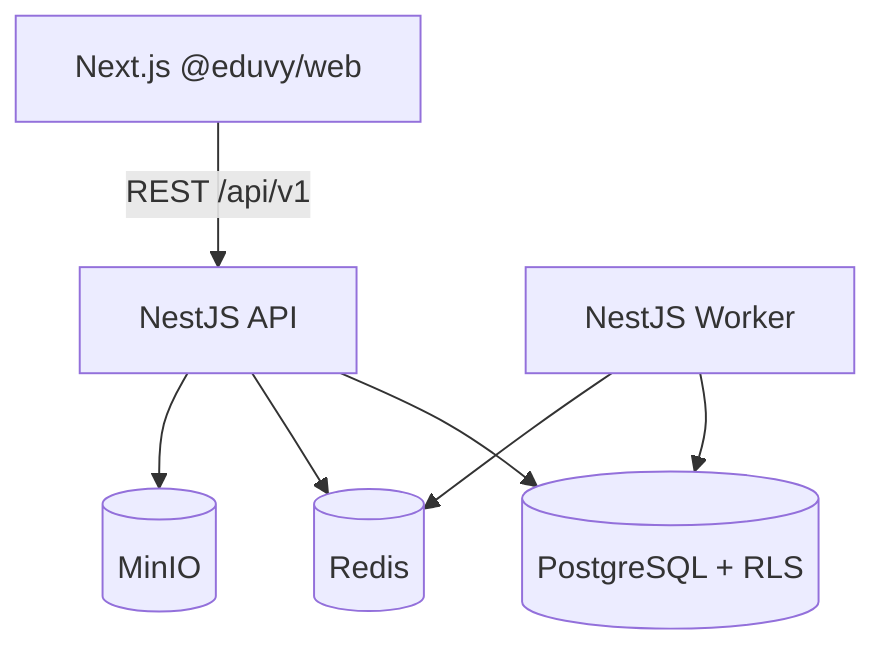

# Eduvy — Relatório da Fundação Backend (Fase 0–7 parcial)

## 1. Notas

| | Nota |
|---|------|
| Arquitetura anterior (backend) | **0/10** — inexistente |
| Arquitetura atual (fundação) | **7/10** — alicerce real, pendências operacionais |

## 2. Estrutura de pastas

```text
eduvy/
├── src/                    # @eduvy/web (Next.js — preservado)
├── apps/
│   ├── api/                # NestJS REST /api/v1
│   └── worker/             # BullMQ + outbox dispatcher
├── packages/
│   ├── config/             # Zod env validation
│   ├── contracts/          # Permissões, filas, erros
│   ├── database/           # Prisma + RLS SQL + seeds
│   ├── logger/             # Pino + redaction
│   └── tsconfig/
├── docs/architecture/
├── docs/adr/
├── docker-compose.yml
└── .env.example
```

## 3. Comandos

```bash
pnpm infra:up          # Docker: Postgres, Redis, MinIO
pnpm db:migrate        # Prisma migrate dev
pnpm db:deploy         # migrate + roles + RLS
pnpm db:seed           # dados fictícios
pnpm db:verify-rls     # verifica FORCE RLS
pnpm dev:api           # API :4000
pnpm dev:worker        # Worker :4001
pnpm dev               # Web :3000
```

## 4. Validação executada

| Comando | Resultado |
|---------|-----------|
| `pnpm typecheck` (web) | ✅ Passou |
| `pnpm lint` | ✅ Passou |
| `pnpm build` (web) | ✅ Passou (26 rotas) |
| `pnpm --filter @eduvy/api build` | ✅ Passou |
| `pnpm --filter @eduvy/worker build` | ✅ Passou |
| `pnpm build:packages` | ✅ Passou |
| Docker Compose | ⚠️ Docker Desktop não estava em execução |
| Migrações / RLS / testes integração | ⚠️ Requer Postgres local |

## 5. Diagrama arquitetural



## 6. Tabelas globais (control plane)

users, auth_identities, sessions, tenants, tenant_domains, plans, plan_versions, module_catalog, plan_entitlements, subscriptions, subscription_items, billing_webhook_events, platform_audit_logs, permissions, role_templates

## 7. Tabelas tenant-scoped (amostra)

memberships, tenant_roles, role_permissions, membership_role_assignments, invitations, groups, tenant_entitlements, courses, course_versions, cohorts, enrollments, files, audit_logs, outbox_events, dead_letter_jobs, api_keys, …

## 8. RLS

- Políticas em `packages/database/sql/rls/001_tenant_policies.sql`
- Verificação: `pnpm db:verify-rls`
- Testes adversariais: `packages/database/tests/rls.integration.test.ts`

## 9. Filas BullMQ

email, notifications, certificates, media-processing, file-scanning, imports, exports, analytics, webhooks, billing, maintenance, outbox

## 10. DLQ

- Persistência: `dead_letter_jobs`
- Serviço: `apps/worker/src/dlq/dlq.service.ts`

## 11. Outbox

- Tabela: `outbox_events`
- Dispatcher: worker `outbox.dispatcher.ts` (FOR UPDATE SKIP LOCKED)

## 12. Papéis padrão (templates)

TENANT_OWNER, TENANT_ADMIN, ACADEMIC_MANAGER, INSTRUCTOR, STUDENT, … (via `role_templates` + seeds)

## 13. Riscos restantes

1. Docker não validado nesta sessão — migrar/RLS/seed manualmente após `pnpm infra:up`
2. JWT/cookies HTTP-only — login retorna refresh token no body (integrar cookies + CSRF na Fase 2)
3. OpenTelemetry — bootstrap preparado, exportador OTLP opcional
4. Testcontainers — testes RLS prontos, execução pendente de Postgres
5. Frontend ainda usa mocks — integração API gradual

## 14. Próxima fase recomendada

**Fase 2–3:** Cookies seguros, guards de auth em todas as rotas, MFA para admins, testes adversariais RLS em CI, integração login web → API.
