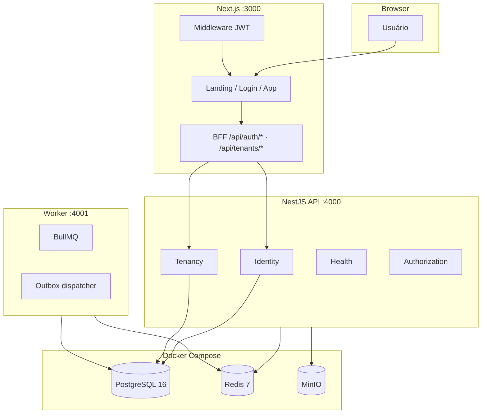
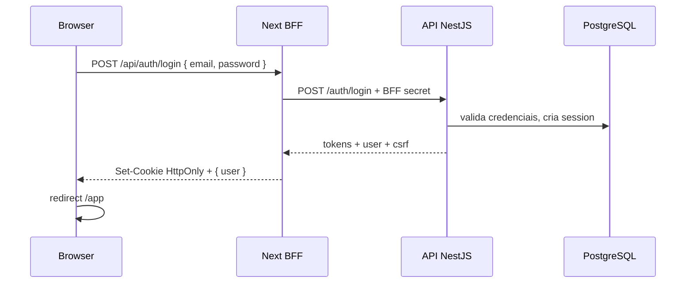

# Eduvy — Infraestrutura e guia do projeto

Documento de referência sobre a arquitetura, infraestrutura local, integração front/back e operação do monorepo Eduvy.

> **Documentos relacionados:** [Visão geral](./architecture/00-overview.md) · [Multi-tenancy](./architecture/02-multi-tenancy.md) · [RLS](./architecture/03-rls.md) · [ADRs](./adr/ADR-001-modular-monolith.md)

---

## 1. O que é o Eduvy

Plataforma SaaS modular de aprendizagem (LMS), multi-tenant, com:

- **Landing page** e **login** públicos
- **Plataforma** autenticada em `/app/*`
- **API REST** NestJS
- **Worker** assíncrono (filas, outbox)
- **PostgreSQL** com Row Level Security (RLS)
- **Redis** + **MinIO** (S3-compatible) para filas e arquivos

---

## 2. Visão de alto nível



### Por que BFF no Next.js?

O browser fala com **`:3000`** (same-origin). A API roda em **`:4000`**. Cookies HttpOnly não funcionam bem entre portas diferentes. O **BFF** (Backend-for-Frontend) no Next.js:

1. Recebe requests do browser em `/api/*`
2. Chama a API NestJS com header secreto `X-Eduvy-BFF-Secret`
3. Grava cookies seguros (`eduvy_access`, `eduvy_refresh`, `eduvy_tenant`, etc.)

---

## 3. Estrutura do monorepo

```
eduvy/
├── src/                    # @eduvy/web — Next.js 16 (App Router)
├── apps/
│   ├── api/                # @eduvy/api — NestJS REST
│   └── worker/             # @eduvy/worker — BullMQ + outbox
├── packages/
│   ├── database/           # Prisma schema, migrations, RLS SQL, seeds
│   ├── config/             # Validação de env (Zod)
│   ├── contracts/          # DTOs e constantes compartilhadas
│   ├── logger/             # Pino estruturado
│   └── tsconfig/           # TS configs base
├── docs/                   # Documentação de arquitetura
├── docker-compose.yml      # Infra local
├── .env.example            # Template de variáveis
├── pnpm-workspace.yaml
└── package.json            # Scripts raiz
```

Gerenciado com **pnpm workspaces** (`.npmrc`: `node-linker=hoisted` para compatibilidade com Next.js).

---

## 4. Aplicações

### 4.1 Web — `@eduvy/web` (porta 3000)

| Área | Rotas | Descrição |
|------|-------|-----------|
| Marketing | `/` | Landing page |
| Auth | `/login` | Formulário de login real |
| Plataforma | `/app/*` | Dashboard e módulos (protegidos) |
| BFF Auth | `/api/auth/login`, `logout`, `refresh`, `session` | Proxy de autenticação |
| BFF Tenant | `/api/tenants/context`, `active` | Contexto de organização |

**Stack:** Next.js 16, React 19, TypeScript, Tailwind v4, Framer Motion, Radix UI.

**Proteção:** `src/middleware.ts` valida JWT no cookie `eduvy_access` para rotas `/app/*`.

**Layout da plataforma:** `src/app/(platform)/app/layout.tsx` carrega sessão + tenant ativo no servidor e injeta no shell (sidebar, topbar).

### 4.2 API — `@eduvy/api` (porta 4000)

Monólito modular NestJS com prefixo global `/api/v1`.

| Módulo | Responsabilidade |
|--------|------------------|
| `identity` | Login, register, refresh, logout, `/auth/me` |
| `tenancy` | Onboard tenant, `GET /tenants/mine` |
| `authorization` | RBAC, permissões |
| `entitlements` | Módulos/planos contratados |
| `audit` | Log de auditoria append-only |
| `outbox` | Eventos transacionais |
| `health` | Liveness/readiness |

**Guards globais:**

- `JwtAuthGuard` — Bearer ou cookie `eduvy_access`
- `BffSecretGuard` — rotas `@BffOnly()` exigem `X-Eduvy-BFF-Secret`
- `ThrottlerGuard` — rate limit

**Swagger:** http://localhost:4000/api/docs

**Dev:** `tsx watch --env-file=../../.env src/main.ts` (carrega `.env` da raiz).

### 4.3 Worker — `@eduvy/worker` (porta 4001)

Processa jobs BullMQ:

- `email` — envio de e-mails (placeholder)
- `outbox` — fan-out de eventos
- **Outbox dispatcher** — polling com `FOR UPDATE SKIP LOCKED`
- **DLQ** — dead letter em `dead_letter_jobs`

Opcional para login/tenant; necessário para pipelines assíncronos.

---

## 5. Packages compartilhados

### `@eduvy/database`

- **Prisma schema:** ~45 modelos (users, sessions, tenants, memberships, courses, outbox, etc.)
- **RLS:** `packages/database/sql/rls/001_tenant_policies.sql`
- **Roles PG:** `packages/database/sql/roles/001_roles.sql`
- **`TenantDatabase.run()`** — executa queries com `set_config('app.tenant_id', ...)`
- **Seed:** 3 tenants demo + usuário `owner@horizonte.demo`

### `@eduvy/config`

Schemas Zod para env:

- `loadApiEnv()` — API
- `loadWorkerEnv()` — Worker
- `loadWebAuthEnv()` — BFF Next.js

### `@eduvy/contracts`

Constantes e DTOs compartilhados:

- `AUTH_COOKIES`, `AUTH_HEADERS`
- `PERMISSIONS`, `MODULE_CODES`, `QUEUE_NAMES`
- `AuthLoginResponseDto`, `TenantContextDto`, etc.

### `@eduvy/logger`

Logger Pino com redaction de campos sensíveis.

---

## 6. Infraestrutura local (Docker Compose)

| Serviço | Imagem | Porta | Uso |
|---------|--------|-------|-----|
| **postgres** | postgres:16-alpine | 5432 | Banco principal + RLS |
| **redis** | redis:7-alpine | 6379 | BullMQ, cache |
| **minio** | minio/minio | 9000 (API), 9001 (console) | Storage S3-compatible |
| **minio-init** | minio/mc | — | Cria buckets `eduvy-quarantine`, `eduvy-private` |

```bash
pnpm infra:up      # sobe containers
pnpm infra:down    # derruba containers
```

### Credenciais de desenvolvimento

| Recurso | Valor |
|---------|-------|
| Postgres (migration) | `eduvy_migration` / `eduvy_migration_dev` |
| Postgres (app) | `eduvy_app` / `eduvy_app_dev` |
| Redis | sem senha, `localhost:6379` |
| MinIO | `eduvy_minio` / `eduvy_minio_dev_secret` |

> Roles SQL (`eduvy_app`, `eduvy_migration`) são criados pelo script `sql:roles` após migrate.

---

## 7. Banco de dados

### Fluxo de setup

```bash
pnpm db:generate                              # Prisma Client
pnpm db:migrate                               # Migrations (dev)
pnpm --filter @eduvy/database sql:post-migrate  # Roles + RLS
pnpm db:seed                                  # Dados demo
pnpm db:verify-rls                            # Testes RLS (requer Postgres)
```

### Multi-tenancy

- Toda entidade de negócio tenant-scoped tem `tenant_id`
- FKs compostas `(tenant_id, id)` onde aplicável
- RLS filtra linhas por `current_setting('app.tenant_id')`
- Usuário pode pertencer a **várias organizações** via `memberships`

Ver [02-multi-tenancy.md](./architecture/02-multi-tenancy.md) e [03-rls.md](./architecture/03-rls.md).

### Seed demo

| Campo | Valor |
|-------|-------|
| E-mail | `owner@horizonte.demo` |
| Senha | `Eduvy@2026!` |
| Tenants | Escola Horizonte, Academia Atlas, Preparatório Prisma |

---

## 8. Autenticação e sessão

### Fluxo de login



### Cookies

| Cookie | HttpOnly | Função |
|--------|----------|--------|
| `eduvy_access` | Sim | JWT access (15 min default) |
| `eduvy_refresh` | Sim | Refresh token rotacionável |
| `eduvy_session` | Sim | ID da sessão no banco |
| `eduvy_csrf` | Não | Proteção CSRF (futuro) |
| `eduvy_tenant` | Sim | Organização ativa |

### Tenant ativo

- `GET /api/v1/tenants/mine` — lista orgs do usuário (API)
- `GET /api/tenants/context` — contexto para o front (BFF)
- `POST /api/tenants/active` — troca org + atualiza cookie

---

## 9. Variáveis de ambiente

Copie `.env.example` → `.env` na **raiz** do monorepo.

### Críticas para front + API funcionarem juntos

| Variável | Onde | Regra |
|----------|------|-------|
| `EDUVY_API_URL` | Next BFF | `http://localhost:4000/api/v1` |
| `EDUVY_BFF_SECRET` | Next BFF | **Igual** a `BFF_SHARED_SECRET` |
| `BFF_SHARED_SECRET` | API | **Igual** a `EDUVY_BFF_SECRET` |
| `JWT_ACCESS_SECRET` | API + Next middleware | **Mesmo valor** |
| `DATABASE_URL` | API, Worker, Prisma | Postgres app role |
| `REDIS_URL` | API, Worker | `redis://localhost:6379` |

### Segurança

- Secrets devem ter **mínimo 32 caracteres** (validado por Zod)
- **Nunca** commitar `.env` real
- `OTEL_EXPORTER_OTLP_ENDPOINT` vazio é ignorado (opcional)

---

## 10. Como rodar localmente

### Pré-requisitos

- Node.js 20+ (testado com 24)
- pnpm
- Docker Desktop (para Postgres, Redis, MinIO)

### Setup inicial (uma vez)

```powershell
cd eduvy
pnpm install --force
Copy-Item .env.example .env

pnpm db:generate
pnpm build:packages

pnpm infra:up
pnpm db:migrate
pnpm --filter @eduvy/database sql:post-migrate
pnpm db:seed
```

### Desenvolvimento (3 terminais)

```powershell
# Terminal 1 — API
pnpm dev:api

# Terminal 2 — Front
pnpm dev

# Terminal 3 — Worker (opcional)
pnpm dev:worker
```

### URLs

| Serviço | URL |
|---------|-----|
| Front | http://localhost:3000 |
| Login | http://localhost:3000/login |
| Plataforma | http://localhost:3000/app |
| API | http://localhost:4000/api/v1 |
| Swagger | http://localhost:4000/api/docs |
| MinIO Console | http://localhost:9001 |

### Verificação rápida

```powershell
# API viva
curl http://localhost:4000/api/v1/health/live

# Login demo → redireciona para /app
# owner@horizonte.demo / Eduvy@2026!
```

---

## 11. Scripts disponíveis (raiz)

| Script | Descrição |
|--------|-----------|
| `pnpm dev` | Next.js dev server |
| `pnpm dev:api` | API NestJS (watch) |
| `pnpm dev:worker` | Worker BullMQ |
| `pnpm build` | Build produção Next.js |
| `pnpm build:api` | Compila API (tsc) |
| `pnpm build:packages` | Compila packages TypeScript |
| `pnpm typecheck` | Typecheck do web |
| `pnpm typecheck:all` | Typecheck de todo o monorepo |
| `pnpm lint` | ESLint |
| `pnpm infra:up` / `infra:down` | Docker Compose |
| `pnpm db:generate` | Prisma generate |
| `pnpm db:migrate` | Prisma migrate dev |
| `pnpm db:seed` | Seed demo |
| `pnpm db:verify-rls` | Testes integração RLS |

---

## 12. Frontend — organização

```
src/
├── app/
│   ├── page.tsx              # Landing
│   ├── login/                # Login
│   ├── (platform)/app/       # Plataforma autenticada
│   └── api/                  # BFF routes
├── components/
│   ├── auth/                 # LoginForm, LogoutButton
│   ├── platform/             # Shell, dashboard, shared UI
│   └── ui/                   # Design system base
├── lib/
│   ├── auth/                 # cookies, session, api-server
│   └── tenancy/              # context, cookies tenant
├── config/                   # Navegação, assets
└── middleware.ts             # Proteção /app/*
```

**Estado atual da plataforma:** UI completa com empty states honestos; dados de negócio (cursos, alunos, etc.) aguardam endpoints API. Identidade e tenant vêm da sessão real.

---

## 13. API — endpoints principais

| Método | Rota | Auth | Descrição |
|--------|------|------|-----------|
| POST | `/auth/login` | BFF only | Login |
| POST | `/auth/register` | BFF only | Registro |
| POST | `/auth/refresh` | BFF only | Renovar tokens |
| POST | `/auth/logout` | JWT | Encerrar sessão |
| GET | `/auth/me` | JWT | Usuário atual |
| GET | `/tenants/mine` | JWT | Organizações do usuário |
| POST | `/tenants` | BFF only | Criar tenant (onboard) |
| GET | `/health/live` | Público | Liveness |
| GET | `/health/ready` | Público | Readiness |

---

## 14. Princípios arquiteturais

1. **Monólito modular** — fronteiras de domínio claras; microserviços só quando necessário
2. **Multi-tenant shared DB + RLS** — isolamento no PostgreSQL
3. **Fail closed** — auth/RBAC negam por padrão
4. **Outbox transacional** — eventos consistentes com o banco
5. **Auditoria append-only** — trilha de ações sensíveis
6. **BFF same-origin** — cookies seguros sem expor tokens à API cross-port

ADRs completos em `docs/adr/`.

---

## 15. Problemas comuns

| Sintoma | Causa provável | Solução |
|---------|----------------|---------|
| `nest.js` / `prisma` not found | pnpm hoisted + bin local quebrado | `pnpm install --force`; API usa `tsx watch` |
| Login falha | API offline ou secrets diferentes | Verificar `.env`, `pnpm dev:api` |
| `/app` → login | JWT inválido/expirado | Login de novo; conferir `JWT_ACCESS_SECRET` |
| Docker compose falha | Docker Desktop parado | Abrir Docker Desktop |
| `.prisma/client` missing | Client não gerado | `pnpm db:generate` |
| Hydration warning `cz-shortcut-listen` | Extensão Chrome | Ignorar ou aba anônima; `suppressHydrationWarning` no layout |
| `GET /sw.js 404` | Service worker inexistente | Ignorar; limpar cache localhost |

---

## 16. Roadmap técnico (próximas fases)

- [ ] CRUD de cursos escopado ao tenant ativo
- [ ] RBAC aplicado nas rotas de negócio
- [ ] Refresh silencioso de sessão no layout
- [ ] Upload de mídia via MinIO
- [ ] Processadores reais no worker (e-mail, certificados)
- [ ] CI/CD + deploy (staging/prod)
- [ ] Observabilidade (OpenTelemetry)

---

## 17. Referência rápida — diagrama de deploy local

```
┌─────────────────────────────────────────────────────────────┐
│  localhost:3000  Next.js (@eduvy/web)                       │
│  ├── /              landing                                  │
│  ├── /login         auth UI                                 │
│  ├── /app/*         plataforma (middleware JWT)             │
│  └── /api/*         BFF → API                               │
└──────────────────────────┬──────────────────────────────────┘
                           │ HTTP + BFF secret
┌──────────────────────────▼──────────────────────────────────┐
│  localhost:4000  NestJS (@eduvy/api)                        │
│  └── /api/v1/*                                              │
└──────┬─────────────────┬─────────────────┬──────────────────┘
       │                 │                 │
       ▼                 ▼                 ▼
  PostgreSQL:5432   Redis:6379      MinIO:9000
       ▲
       │ polling outbox
┌──────┴──────────────────────────────────────────────────────┐
│  localhost:4001  Worker (@eduvy/worker)                     │
└─────────────────────────────────────────────────────────────┘
```

---

*Última atualização: julho/2026 — reflete auth BFF, tenant context e remoção de mocks da plataforma.*
