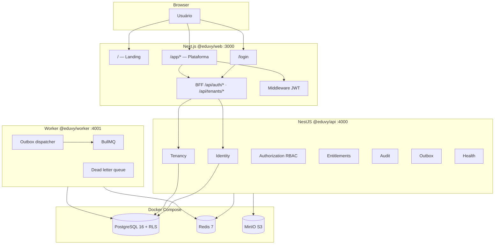
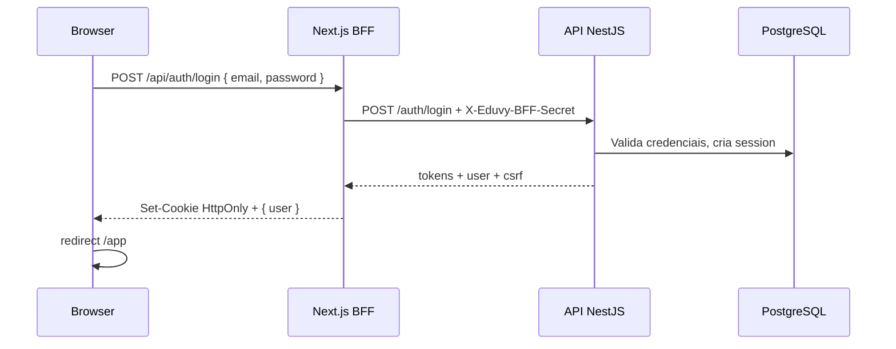
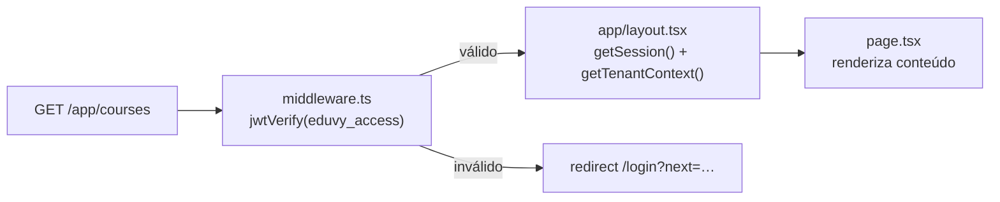
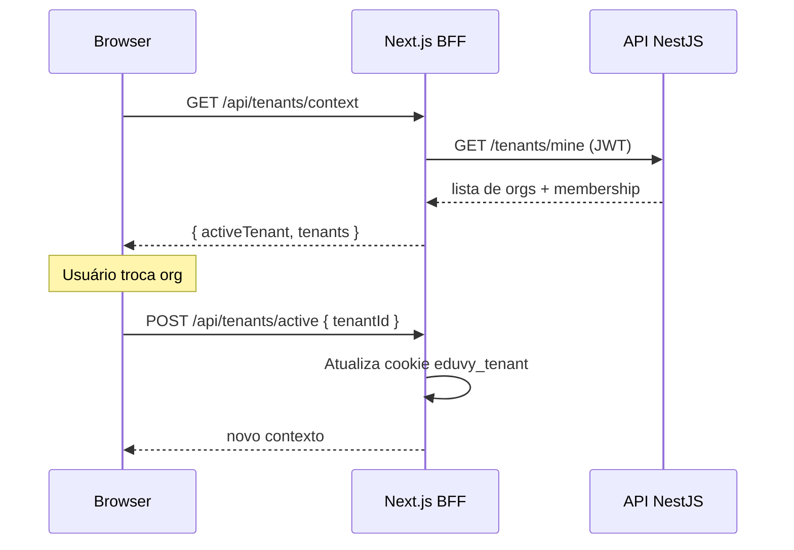
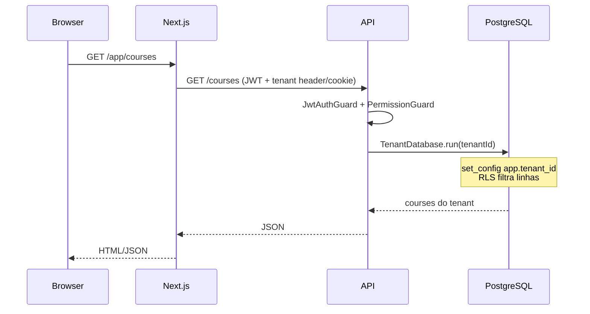
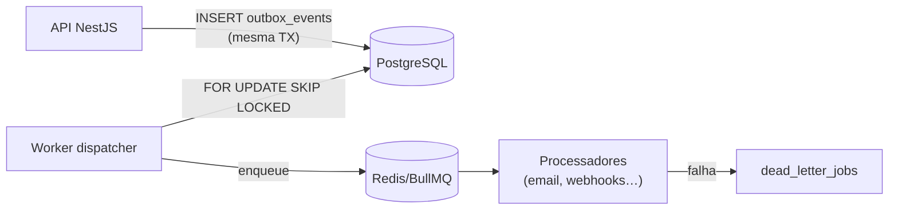

# Eduvy — Visão completa do projeto

Documento de referência sobre **o que é o Eduvy**, **como está organizado hoje**, **como a infraestrutura funciona** e **quais são os fluxos principais**. Serve como ponto de entrada para novos desenvolvedores e stakeholders técnicos.

> **Documentos relacionados**
> - [Infraestrutura e operação](./infraestrutura.md) — guia prático de setup, env vars e troubleshooting
> - [Visão arquitetural](./architecture/00-overview.md) — resumo técnico
> - [Multi-tenancy](./architecture/02-multi-tenancy.md) · [RLS](./architecture/03-rls.md)
> - [ADRs](./adr/ADR-001-modular-monolith.md) — decisões arquiteturais
> - [Relatório da fundação backend](./architecture/foundation-report.md)

*Última atualização: agosto/2026*

---

## 1. O que é o Eduvy

O **Eduvy** é uma **plataforma SaaS modular de aprendizagem (LMS)** voltada para empresas, escolas, cursinhos, professores autônomos e organizações educacionais.

### Proposta de valor

| Pilar | Descrição |
|-------|-----------|
| **Crie** | Organize cursos, aulas, materiais e trilhas em uma experiência clara |
| **Engaje** | Gamificação, fórum, desafios e comunidade para manter alunos ativos |
| **Evolua** | Analytics e relatórios para acompanhar desempenho e habilidades |

A plataforma é **modular**: cada organização contrata apenas os módulos que precisa (redações, simulados, banco de questões, fórum, gamificação, certificados, integrações, etc.) e pode expandir conforme cresce.

### Públicos-alvo

- **Empresas** — treinamentos internos, onboarding e trilhas por cargo
- **Escolas e cursinhos** — reforço, preparatório e acompanhamento contínuo
- **Professores** — cursos profissionais com turmas e comunidade
- **Organizações educacionais** — programas de capacitação com visão institucional

### Modelo de negócio (visão)

- SaaS **multi-tenant**: uma instância atende várias organizações isoladas
- **Planos** com limites e módulos incluídos (`plans`, `subscriptions`, `tenant_entitlements`)
- Módulos adicionais contratáveis via catálogo (`module_catalog`)

---

## 2. Estado atual do projeto

O projeto está em **fase de fundação (Fase 0–1 concluída parcialmente)**. O frontend foi desenvolvido primeiro; o backend real foi adicionado em 2026.

### O que já funciona de ponta a ponta

| Área | Status |
|------|--------|
| Landing page marketing | ✅ Completa (Next.js, animações, seções modulares) |
| Login real | ✅ BFF + API + sessão no PostgreSQL |
| Proteção de rotas `/app/*` | ✅ Middleware JWT + layout server-side |
| Multi-tenancy (contexto) | ✅ Usuário em várias orgs; troca de tenant ativo |
| API de identidade | ✅ Login, register, refresh, logout, `/auth/me` |
| API de tenancy | ✅ Onboard, listar orgs do usuário |
| Banco de dados | ✅ 41 modelos Prisma + RLS + seeds demo |
| Worker + outbox | ✅ Estrutura BullMQ + dispatcher (jobs placeholder) |
| Infra local | ✅ Docker Compose (Postgres, Redis, MinIO) |

### O que ainda é UI sem backend de negócio

As páginas da plataforma em `/app/*` têm **shell completo** (sidebar, topbar, navegação, empty states honestos), mas **não consomem endpoints de domínio** ainda:

- Cursos, turmas, alunos, professores
- Conteúdos, avaliações, redações, simulados
- Banco de questões, fórum, gamificação, certificados
- Relatórios, módulos, integrações, configurações

Ou seja: a **experiência visual e a navegação estão prontas**; os **CRUDs e regras de negócio** são a próxima fase.

### Nota de maturidade (referência interna)

| Camada | Nota aproximada |
|--------|-----------------|
| Frontend (UI/UX) | 8/10 |
| Fundação backend | 7/10 |
| Domínio educacional (CRUDs) | 1/10 |
| CI/CD e produção | 0/10 |

---

## 3. Arquitetura de alto nível



### Princípios arquiteturais

1. **Monólito modular** — domínios separados no código; microserviços só quando necessário
2. **Multi-tenant shared DB + RLS** — isolamento no PostgreSQL, não na aplicação
3. **Fail closed** — autenticação e RBAC negam por padrão
4. **Outbox transacional** — eventos consistentes com commits do banco
5. **Auditoria append-only** — trilha imutável de ações sensíveis
6. **BFF same-origin** — cookies HttpOnly sem expor tokens cross-port

Decisões detalhadas nos [ADRs](./adr/ADR-001-modular-monolith.md).

---

## 4. Estrutura do monorepo

Gerenciado com **pnpm workspaces** (`pnpm-workspace.yaml`, `.npmrc` com `node-linker=hoisted` para compatibilidade com Next.js).

```
eduvy/
├── src/                          # @eduvy/web — Next.js 16 (App Router)
│   ├── app/
│   │   ├── (marketing)/          # Landing pública (/)
│   │   ├── login/                # Autenticação
│   │   ├── (platform)/app/       # Plataforma autenticada
│   │   └── api/                  # BFF (auth, tenants)
│   ├── components/
│   │   ├── landing/              # Seções da landing page
│   │   ├── platform/             # Shell, dashboard, UI da plataforma
│   │   ├── auth/                 # LoginForm, LogoutButton
│   │   ├── layout/               # Header, footer, menu mobile
│   │   └── ui/                   # Design system base (Button, Input…)
│   ├── config/                   # Navegação, assets, tokens visuais
│   ├── data/                     # Conteúdo estático da landing
│   ├── lib/                      # Auth, tenancy, helpers
│   ├── hooks/                    # Hooks React (ex.: reduced motion)
│   ├── types/                    # Tipos TypeScript
│   └── middleware.ts             # Proteção JWT em /app/*
│
├── apps/
│   ├── api/                      # @eduvy/api — NestJS REST /api/v1
│   │   └── src/
│   │       ├── modules/          # Domínios (identity, tenancy, …)
│   │       └── common/           # Guards, filters, interceptors, DB
│   └── worker/                   # @eduvy/worker — BullMQ + outbox
│       └── src/
│           ├── dlq/              # Dead letter queue
│           └── outbox/           # Dispatcher transacional
│
├── packages/
│   ├── database/                 # Prisma schema, migrations, RLS, seeds
│   ├── config/                   # Validação de env (Zod)
│   ├── contracts/                # DTOs, permissões, constantes compartilhadas
│   ├── logger/                   # Pino estruturado + redaction
│   └── tsconfig/                 # Configs TypeScript base
│
├── docs/                         # Documentação (este arquivo e demais)
├── public/                       # Assets estáticos (imagens, brand)
├── scripts/                      # Utilitários (ex.: optimize-images)
├── docker-compose.yml            # Infra local
├── .env.example                  # Template de variáveis
├── pnpm-workspace.yaml
└── package.json                  # Scripts raiz + dependências do web
```

### Pacotes e responsabilidades

| Pacote | Porta | Função |
|--------|-------|--------|
| `@eduvy/web` | 3000 | Frontend + BFF |
| `@eduvy/api` | 4000 | API REST NestJS |
| `@eduvy/worker` | 4001 | Jobs assíncronos |
| `@eduvy/database` | — | ORM, migrations, RLS |
| `@eduvy/config` | — | Schemas Zod de env |
| `@eduvy/contracts` | — | Contratos compartilhados |
| `@eduvy/logger` | — | Logging estruturado |

---

## 5. Frontend — camadas e rotas

### Stack

Next.js 16 · React 19 · TypeScript · Tailwind CSS v4 · Framer Motion · Radix UI · Recharts · Jose (JWT no middleware)

### Áreas da aplicação

| Área | Rotas | Descrição |
|------|-------|-----------|
| **Marketing** | `/` | Landing page com 12 seções (hero, módulos, planos, FAQ…) |
| **Auth** | `/login` | Formulário de login conectado ao BFF |
| **Plataforma** | `/app/*` | Dashboard e módulos (protegidos por middleware) |
| **BFF Auth** | `/api/auth/login`, `logout`, `refresh`, `session` | Proxy de autenticação |
| **BFF Tenant** | `/api/tenants/context`, `active` | Contexto e troca de organização |

### Landing page — seções

A home (`src/app/(marketing)/page.tsx`) monta:

1. Hero — proposta principal
2. Audience strip — públicos-alvo
3. Value proposition — pilares Crie / Engaje / Evolua
4. Platform — recursos core da plataforma
5. Modular features — módulos contratáveis
6. Gamification — engajamento
7. Mobile app — visão de app mobile
8. Use cases — casos de uso
9. Analytics — relatórios e métricas
10. Modular journey — jornada de contratação
11. Plans — planos e preços
12. FAQ + CTA final

Conteúdo estático centralizado em `src/data/landing.ts`.

### Plataforma — módulos de navegação

Definidos em `src/config/platform-navigation.ts`:

| Seção | Itens |
|-------|-------|
| **Principal** | Visão geral, Cursos, Turmas |
| **Gestão acadêmica** | Alunos, Professores, Conteúdos, Avaliações |
| **Recursos educacionais** | Redações, Banco de questões, Simulados, Fórum |
| **Engajamento** | Gamificação, Certificados |
| **Administração** | Relatórios, Módulos, Integrações, Configurações |

**Shell da plataforma:** `AppShell` com sidebar, topbar, seletor de tenant e menu mobile. O layout (`src/app/(platform)/app/layout.tsx`) carrega sessão e tenant ativo no servidor antes de renderizar.

### Design system

- Tokens CSS em `globals.css` (cores, tipografia Sora/Inter)
- Componentes base em `src/components/ui/`
- Componentes de plataforma em `src/components/platform/ui/`
- Empty states honestos quando não há dados reais

---

## 6. Backend — módulos da API

Monólito NestJS com prefixo global `/api/v1`. Swagger em `http://localhost:4000/api/docs`.

### Módulos implementados

| Módulo | Responsabilidade |
|--------|------------------|
| `identity` | Login, register, refresh, logout, `/auth/me` |
| `tenancy` | Onboard de tenant, `GET /tenants/mine` |
| `authorization` | RBAC — permissões e escopos |
| `entitlements` | Módulos/planos contratados pelo tenant |
| `audit` | Log de auditoria append-only |
| `outbox` | Eventos transacionais para o worker |
| `health` | Liveness (`/health/live`) e readiness (`/health/ready`) |

### Guards e segurança globais

| Guard | Função |
|-------|--------|
| `JwtAuthGuard` | Valida Bearer token ou cookie `eduvy_access` |
| `BffSecretGuard` | Rotas `@BffOnly()` exigem header `X-Eduvy-BFF-Secret` |
| `PermissionGuard` | RBAC por permissão |
| `ThrottlerGuard` | Rate limiting |

### Endpoints principais (hoje)

| Método | Rota | Auth | Descrição |
|--------|------|------|-----------|
| POST | `/auth/login` | BFF only | Login |
| POST | `/auth/register` | BFF only | Registro |
| POST | `/auth/refresh` | BFF only | Renovar tokens |
| POST | `/auth/logout` | JWT | Encerrar sessão |
| GET | `/auth/me` | JWT | Usuário atual |
| GET | `/tenants/mine` | JWT | Organizações do usuário |
| POST | `/tenants` | BFF only | Criar tenant (onboard) |
| GET | `/health/live` | Público | Liveness |
| GET | `/health/ready` | Público | Readiness |

---

## 7. Worker — processamento assíncrono

O worker (`@eduvy/worker`) roda na porta **4001** e processa jobs via **BullMQ** (Redis).

### Filas definidas (`@eduvy/contracts`)

`email`, `notifications`, `certificates`, `media-processing`, `file-scanning`, `imports`, `exports`, `analytics`, `webhooks`, `billing`, `maintenance`, `outbox`

### Componentes

| Componente | Função |
|------------|--------|
| **Outbox dispatcher** | Polling na tabela `outbox_events` com `FOR UPDATE SKIP LOCKED` |
| **DLQ** | Jobs falhos persistidos em `dead_letter_jobs` |
| **Processadores** | Placeholders (e-mail, certificados, etc.) — implementação futura |

O worker é **opcional para login/tenant**, mas **necessário** para pipelines assíncronos (upload, e-mail, certificados, webhooks).

---

## 8. Banco de dados

### Visão geral

- **PostgreSQL 16** com **41 modelos** Prisma
- **Row Level Security (RLS)** para isolamento entre tenants
- **Dois roles** PostgreSQL: `eduvy_migration` (DDL) e `eduvy_app` (runtime com RLS)

### Control plane (global — sem tenant_id)

Dados compartilhados entre todos os tenants:

`users`, `auth_identities`, `sessions`, `tenants`, `tenant_domains`, `plans`, `plan_versions`, `module_catalog`, `plan_entitlements`, `subscriptions`, `subscription_items`, `billing_webhook_events`, `platform_audit_logs`, `permissions`, `role_templates`

### Tenant-scoped (com tenant_id + RLS)

Dados isolados por organização:

`memberships`, `tenant_roles`, `role_permissions`, `membership_role_assignments`, `invitations`, `groups`, `tenant_entitlements`, `courses`, `course_versions`, `cohorts`, `enrollments`, `files`, `audit_logs`, `outbox_events`, `dead_letter_jobs`, `api_keys`, `privacy_requests`, …

### Multi-tenancy

- Um usuário pode pertencer a **várias organizações** via `memberships`
- O tenant ativo fica no cookie `eduvy_tenant`
- Queries tenant-scoped usam `TenantDatabase.run()` com `set_config('app.tenant_id', ...)`
- **Nunca** usar Prisma global para dados tenant-scoped

Ver [02-multi-tenancy.md](./architecture/02-multi-tenancy.md) e [03-rls.md](./architecture/03-rls.md).

### Módulos contratáveis (catálogo)

Definidos em `@eduvy/contracts` como `MODULE_CODES`:

| Código | Módulo |
|--------|--------|
| `CORE_COURSES` | Cursos (core) |
| `ESSAYS` | Redações |
| `SIMULATIONS` | Simulados |
| `QUESTION_BANK` | Banco de questões |
| `FORUM` | Fórum |
| `GAMIFICATION` | Gamificação |
| `CERTIFICATES` | Certificados |
| `ADVANCED_ANALYTICS` | Analytics avançado |
| `INTEGRATIONS` | Integrações |
| `API_ACCESS` | Acesso à API |

### Permissões RBAC (amostra)

`tenant.read`, `tenant.update`, `members.read`, `members.invite`, `courses.read`, `courses.create`, `courses.publish`, `audit.read`, `billing.read`, `entitlements.read`

Escopos: `PLATFORM`, `TENANT`, `ORGANIZATION_UNIT`, `GROUP`, `COURSE`, `COHORT`, `OWN_RESOURCE`

### Papéis padrão (seeds)

`TENANT_OWNER`, `TENANT_ADMIN`, `ACADEMIC_MANAGER`, `INSTRUCTOR`, `STUDENT`, …

### Dados demo (seed)

| Campo | Valor |
|-------|-------|
| E-mail | `owner@horizonte.demo` |
| Senha | `Eduvy@2026!` |
| Tenants | Escola Horizonte, Academia Atlas, Preparatório Prisma |

---

## 9. Infraestrutura

### Docker Compose (desenvolvimento local)

| Serviço | Imagem | Porta host | Uso |
|---------|--------|------------|-----|
| **postgres** | postgres:16-alpine | **5437** → 5432 | Banco principal + RLS |
| **redis** | redis:7-alpine | 6379 | BullMQ, cache |
| **minio** | minio/minio | 9000 (API), 9001 (console) | Storage S3-compatible |
| **minio-init** | minio/mc | — | Cria buckets `eduvy-quarantine`, `eduvy-private` |

```bash
pnpm infra:up      # sobe containers
pnpm infra:down    # derruba containers
```

### Setup do banco

```bash
pnpm db:generate                              # Prisma Client
pnpm db:migrate                               # Migrations (dev)
pnpm --filter @eduvy/database sql:post-migrate  # Roles + RLS
pnpm db:seed                                  # Dados demo
pnpm db:verify-rls                            # Testes RLS
```

### Credenciais de desenvolvimento

| Recurso | Valor |
|---------|-------|
| Postgres (migration) | `eduvy_migration` / `eduvy_migration_dev` @ `localhost:5437` |
| Postgres (app) | `eduvy_app` / `eduvy_app_dev` @ `localhost:5437` |
| Redis | sem senha, `localhost:6379` |
| MinIO | `eduvy_minio` / `eduvy_minio_dev_secret` |

### Variáveis críticas (`.env` na raiz)

| Variável | Onde | Regra |
|----------|------|-------|
| `EDUVY_API_URL` | Next BFF | `http://localhost:4000/api/v1` |
| `EDUVY_BFF_SECRET` | Next BFF | **Igual** a `BFF_SHARED_SECRET` |
| `BFF_SHARED_SECRET` | API | **Igual** a `EDUVY_BFF_SECRET` |
| `JWT_ACCESS_SECRET` | API + Next middleware | **Mesmo valor** |
| `DATABASE_URL` | API, Worker, Prisma | Role `eduvy_app` |
| `REDIS_URL` | API, Worker | `redis://localhost:6379` |

Detalhes completos em [infraestrutura.md](./infraestrutura.md).

---

## 10. Fluxos principais

### 10.1 Por que existe o BFF?

O browser fala com **`:3000`** (same-origin). A API roda em **`:4000`**. Cookies HttpOnly não funcionam bem entre portas diferentes.

O **BFF** (Backend-for-Frontend) no Next.js:

1. Recebe requests do browser em `/api/*`
2. Chama a API NestJS com header secreto `X-Eduvy-BFF-Secret`
3. Grava cookies seguros (`eduvy_access`, `eduvy_refresh`, `eduvy_tenant`, etc.)

### 10.2 Fluxo de login



### 10.3 Cookies de sessão

| Cookie | HttpOnly | Função |
|--------|----------|--------|
| `eduvy_access` | Sim | JWT access (~15 min) |
| `eduvy_refresh` | Sim | Refresh token rotacionável |
| `eduvy_session` | Sim | ID da sessão no banco |
| `eduvy_csrf` | Não | Proteção CSRF (futuro) |
| `eduvy_tenant` | Sim | Organização ativa |

### 10.4 Proteção de rotas da plataforma



Dupla camada: middleware (edge) + layout server-side (sessão + tenant).

### 10.5 Contexto de tenant



### 10.6 Fluxo de request tenant-scoped (futuro)

Quando os CRUDs de negócio forem implementados:



### 10.7 Outbox transacional (eventos)



Garante que eventos de domínio só são publicados se o commit do banco succeeder.

---

## 11. Como rodar localmente

### Pré-requisitos

- Node.js 20+ (testado com 24)
- pnpm
- Docker Desktop

### Setup inicial (uma vez)

```powershell
cd eduvy
pnpm install --force
Copy-Item .env.example .env

pnpm db:generate
pnpm build:packages

pnpm infra:up
pnpm db:migrate
pnpm --filter @eduvy/database sql:post-migrate
pnpm db:seed
```

### Desenvolvimento (3 terminais)

```powershell
pnpm dev:api      # Terminal 1 — API :4000
pnpm dev          # Terminal 2 — Front :3000
pnpm dev:worker   # Terminal 3 — Worker :4001 (opcional)
```

### URLs

| Serviço | URL |
|---------|-----|
| Front | http://localhost:3000 |
| Login | http://localhost:3000/login |
| Plataforma | http://localhost:3000/app |
| API | http://localhost:4000/api/v1 |
| Swagger | http://localhost:4000/api/docs |
| MinIO Console | http://localhost:9001 |

---

## 12. Roadmap técnico

### Próximas fases (prioridade sugerida)

1. **CRUD de cursos** escopado ao tenant ativo
2. **RBAC aplicado** nas rotas de negócio
3. **Refresh silencioso** de sessão no layout da plataforma
4. **Upload de mídia** via MinIO (quarantine → scan → private)
5. **Processadores reais** no worker (e-mail, certificados, imports)
6. **Integração gradual** das páginas `/app/*` com a API
7. **CI/CD** + deploy (staging/prod)
8. **Observabilidade** (OpenTelemetry)

### Evolução futura (arquitetura preparada)

- SSO / SAML / OIDC (`AuthProvider` enum)
- Tenant enterprise em banco dedicado
- White-label via `tenant_domains`
- MFA para administradores
- API pública com `api_keys`
- LGPD via `privacy_requests`

---

## 13. Diagrama de deploy local (referência rápida)

```
┌─────────────────────────────────────────────────────────────┐
│  localhost:3000  Next.js (@eduvy/web)                       │
│  ├── /              landing (marketing)                     │
│  ├── /login         auth UI                                 │
│  ├── /app/*         plataforma (middleware JWT)             │
│  └── /api/*         BFF → API                               │
└──────────────────────────┬──────────────────────────────────┘
                           │ HTTP + X-Eduvy-BFF-Secret
┌──────────────────────────▼──────────────────────────────────┐
│  localhost:4000  NestJS (@eduvy/api)                        │
│  └── /api/v1/*    identity · tenancy · health · …           │
└──────┬─────────────────┬─────────────────┬──────────────────┘
       │                 │                 │
       ▼                 ▼                 ▼
  PostgreSQL:5437   Redis:6379      MinIO:9000
       ▲
       │ polling outbox
┌──────┴──────────────────────────────────────────────────────┐
│  localhost:4001  Worker (@eduvy/worker)                     │
│  └── BullMQ · outbox dispatcher · DLQ                       │
└─────────────────────────────────────────────────────────────┘
```

---

## 14. Índice de documentação

| Documento | Conteúdo |
|-----------|----------|
| **Este arquivo** | Visão holística do projeto |
| [infraestrutura.md](./infraestrutura.md) | Setup, env, scripts, troubleshooting |
| [architecture/00-overview.md](./architecture/00-overview.md) | Resumo arquitetural |
| [architecture/02-multi-tenancy.md](./architecture/02-multi-tenancy.md) | Modelo multi-tenant |
| [architecture/03-rls.md](./architecture/03-rls.md) | Row Level Security |
| [architecture/foundation-report.md](./architecture/foundation-report.md) | Relatório da fundação backend |
| [architecture/00-audit-report.md](./architecture/00-audit-report.md) | Auditoria pré-backend |
| [adr/ADR-001-modular-monolith.md](./adr/ADR-001-modular-monolith.md) | Decisões arquiteturais |
